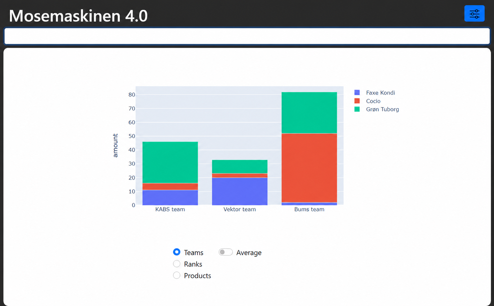

# Mosen (The Swamp Machine)

Mosen (also known as *Mosemaskinen*) is a barcode-based purchase and accounting system used during DTU introduction trips. It replaces the traditional paper *stregsystem*, where participants mark their purchases on a tally sheet, with barcode scanning and automatic accounting.

The application succeeds an older Java version and runs locally on a shared computer. Participants record purchases while administrators manage users, products, stock, payments, and final settlement, even when the internet connection is unreliable.



*Example team purchase dashboard with test data.*

## Features

- **Barcode-based purchases:** Participants scan their barcode and the products they purchase.
- **Administration:** Manage users, products, stock, and purchase corrections.
- **Settlement:** Track purchases and payments and export results for settlement.
- **Statistics:** Review purchases and other operational information in the interface.
- **Local operation:** Use a SQLite database without requiring a hosted backend.
- **Reliability:** Support transactional updates, logging, and backups.

## Using the application

The complete Windows application is packaged in [`swampmachine.exe`](swampmachine.exe). Download or copy this single file to a folder on your Windows computer and double-click it to start. You do not need to install Python or download the source code.

The app automatically creates its database (`beerbase.db`), backups, and logs in its working folder, normally alongside the executable. To move an existing trip to another computer, copy the database and executable. Keeping the trip files together makes them easy to find and remove when no longer needed.

The [administrator documentation](https://thomashelboepoulsen.dk/mosen/docs) explains how to set up and operate the system during a trip. It is also accessible through the **Documentation** button in the administrator login dialog.

## Technology and structure

Mosen uses **Python**, **Dash/Plotly**, and **SQLite**. The kiosk-style desktop interface uses **pywebview**, and the Windows executable is built with **PyInstaller**.

- `main.py` — application entry point and choice of browser or desktop mode
- `app.py` — Dash application initialization
- `src/` — application logic, UI, and database code
- `tests/` — automated tests
- `assets/` — styles and other assets

## Development setup

Python **3.11** and Git are recommended. On Windows, open PowerShell and run:

```powershell
git clone https://github.com/eskehaack/mosen.git
cd mosen
py -3.11 -m venv .venv
.\.venv\Scripts\Activate.ps1
python -m pip install -r requirements.txt
```

### Running the application

In `main.py`, set:

```python
run_in_web = True
```

Then run:

```powershell
python main.py
```

This starts the Dash server for use in your browser at `http://127.0.0.1:8050`. Set `run_in_web = False` to launch the fullscreen desktop interface instead.

### Tests

With the virtual environment active:

```powershell
python -m pytest tests
```

## Building the Windows executable

With the virtual environment active and `run_in_web = False` in `main.py`:

```powershell
pyinstaller -F -n "swampmachine.exe" --distpath "." --clean --icon "assets\favicon.ico" --add-data "assets:assets" --log-level=WARN main.py
```

## Contributing

Please develop changes in a separate branch and submit a pull request. Include or update tests when changing purchase processing, database operations, or settlement logic.
